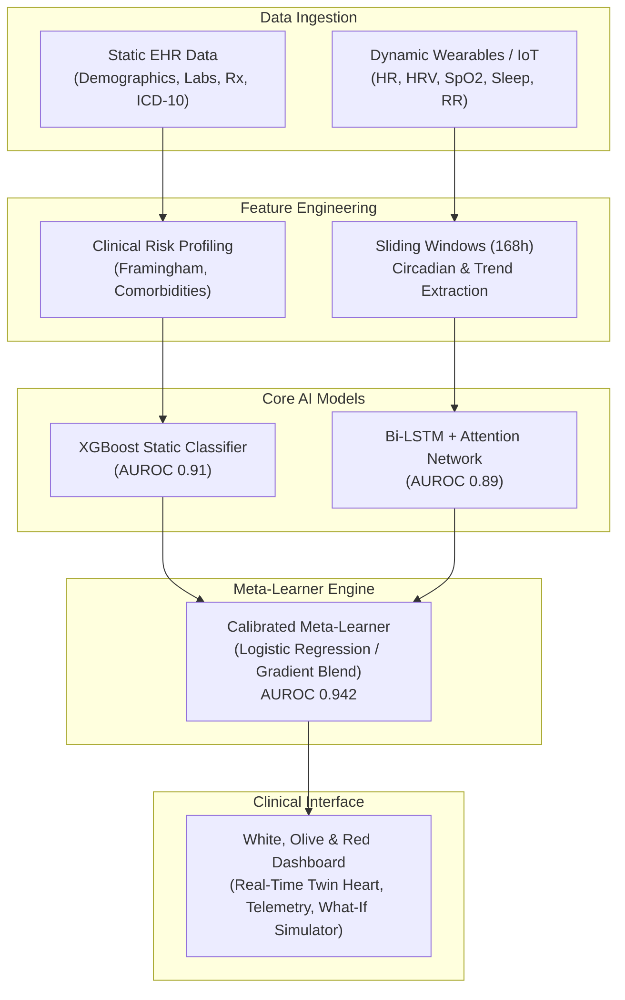

# CardioTwin — Architecture & Submission Assets

This directory contains the architecture diagrams, presentation deck references, and submission documents.

### Files Included:
- **Architecture Diagram**: See below for full Mermaid and block diagram.
- **Presentation Deck**: Outlines project problem, methodology, clinical validation, and outcomes.

